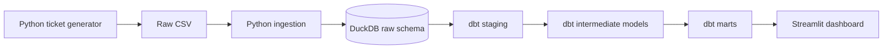

# Priority Engine

**A support-ticket data platform for workload prioritisation, SLA monitoring, and operational analysis.**

Priority Engine turns raw support-ticket records into a structured operational view. It assigns transparent priority scores using ticket severity, customer impact, customer tier, and reopening history. It also evaluates first-response and resolution performance against severity-based service-level targets.

The project demonstrates an end-to-end analytics engineering workflow using Python, DuckDB, dbt, and Streamlit.

> **Dataset notice:** This project uses synthetic support-ticket data generated for demonstration and testing. The dashboard is not connected to a live customer-support system, and its results should not be interpreted as real organisational performance.

## What the project does

Support teams receive requests with different levels of urgency and customer impact. A queue that treats every ticket equally can make it harder to identify the issues that need attention first.

Priority Engine addresses this by:

- Generating a reproducible set of synthetic support tickets.
- Ingesting the raw records into DuckDB.
- Cleaning and transforming the records with dbt.
- Calculating a rule-based priority score and priority band for each ticket.
- Assessing first-response and resolution SLAs.
- Producing analytical fact and dimension models for operational reporting.
- Presenting the results in an interactive Streamlit dashboard.

## Data workflow



### Technology

| Layer | Technology | Responsibility |
|---|---|---|
| Data generation | Python | Creates reproducible synthetic support tickets |
| Ingestion | Python, DuckDB | Loads and validates raw ticket data |
| Warehouse | DuckDB | Stores raw data and analytical models |
| Transformation | dbt Core, dbt-duckdb | Cleans data, calculates priority and SLA measures, and builds marts |
| Dashboard | Streamlit, Plotly | Provides filters, operational summaries, charts, tables, and exports |

## Dataset

The generator creates **800 synthetic support tickets** using a fixed random seed and a fixed reporting snapshot.

| Attribute | Generated values |
|---|---|
| Customers | 250 possible synthetic customer IDs |
| Agents | 12 synthetic agent IDs |
| Categories | Payments, account access, delivery, technical issue, billing, product information |
| Severity | Critical, high, medium, low |
| Customer tiers | Enterprise, premium, standard |
| Channels | Email, chat, phone, web form |
| Ticket statuses | Open, in progress, pending customer, resolved, closed |
| Snapshot | 30 October 2026, 12:00 UTC |

The generator uses a deterministic seed so the same configuration can reproduce the same dataset. Customer tier is assigned at customer level and remains consistent for that customer across their tickets.

## Priority scoring logic

The priority score combines four factors.

| Factor | Classification | Points |
|---|---|---:|
| Severity | Critical | 100 |
| Severity | High | 70 |
| Severity | Medium | 40 |
| Severity | Low | 10 |
| Impact | Widespread | 30 |
| Impact | Multiple customers | 20 |
| Impact | Individual | 5 |
| Customer tier | Enterprise | 15 |
| Customer tier | Premium | 8 |
| Customer tier | Standard | 0 |
| Reopening history | 5 points per reopening, capped at 15 | Up to 15 |

The score is the sum of these components.

### Priority bands

| Priority | Meaning | Rule |
|---|---|---|
| P1 | Critical | Critical severity **or** score of 120 or above |
| P2 | High | Score from 85 to 119 |
| P3 | Standard | Score from 45 to 84 |
| P4 | Low | Score below 45 |

Critical severity always receives P1, irrespective of the total score.

## SLA methodology

SLA targets are determined by ticket severity.

| Severity | First-response target | Resolution target |
|---|---:|---:|
| Critical | 15 minutes | 4 hours |
| High | 1 hour | 12 hours |
| Medium | 4 hours | 48 hours |
| Low | 24 hours | 120 hours |

Each SLA measure is classified separately as `met`, `breached`, `at_risk`, or `on_track`.

- **Met:** The response or resolution occurred within its target.
- **Breached:** The target was missed, or the deadline passed without the required action.
- **At risk:** At least 80% of the allocated SLA time has elapsed and the action has not occurred.
- **On track:** The ticket has not reached the at-risk threshold.

Priority and SLA status measure different things. A P1 ticket can still be within its SLA, while a lower-priority ticket can have breached its target.

**Time assumption:** Version 1 uses elapsed clock hours. It does not implement business-hour calendars, public holidays, pauses, or customer-specific SLA agreements. SLA outcomes are calculated against the fixed dataset snapshot, not against a live clock.

## dbt models

The dbt project builds eight models across staging, intermediate, and mart layers.

| Layer | Model | Purpose |
|---|---|---|
| Staging | `stg_support_tickets` | Cleans and casts raw support-ticket fields |
| Intermediate | `int_ticket_priority_scores` | Calculates score components, total score, priority band, and explanation |
| Intermediate | `int_ticket_sla` | Calculates SLA targets, deadlines, elapsed time, and statuses |
| Mart | `fct_support_tickets` | Combines ticket attributes, priority measures, and SLA outcomes at ticket grain |
| Mart | `dim_customers` | Summarises customer-level ticket activity and satisfaction |
| Mart | `dim_agents` | Summarises agent assignment history |
| Mart | `mart_agent_performance` | Aggregates assigned workload and agent-level outcomes |
| Mart | `mart_category_performance` | Aggregates volume and service outcomes by category |

The raw source tables are `raw.support_tickets` and `raw.ingestion_log`. The default dbt schema configuration creates the analytics models in `analytics_staging`, `analytics_intermediate`, and `analytics_marts`.

## Dashboard

The Streamlit dashboard reads the dbt fact model from DuckDB. It has five connected sections:

1. **Overview:** Ticket volume, open workload, urgent tickets, SLA compliance, priority distribution, incoming demand, and operational signals.
2. **Priority queue:** Open tickets ranked by priority band and score, with priority reasoning and a CSV export.
3. **SLA monitor:** First-response and resolution outcomes, plus at-risk and breached ticket exceptions.
4. **Performance:** Agent workload, agent-level SLA and CSAT summaries, and category performance tables.
5. **Ticket explorer:** Individual ticket information, score components, timestamps, SLA deadlines, and JSON export.

Global filters cover creation date, priority, severity, status, category, customer tier, support channel, agent assignment, SLA status, and ticket search. Unassigned tickets can be included or excluded.

The visual design follows the portfolio theme: cream background, dark ink, orange accent, Bricolage Grotesque headings, Instrument Sans body text, and Geist Mono metadata.

## Project structure

```text
priority-engine/
├── data/
│   ├── raw/
│   │   └── support_tickets.csv
│   └── warehouse/
│       └── priority_engine.duckdb
├── src/
│   └── priority_engine/
│       ├── generate_tickets.py
│       └── ingest.py
├── dbt/
│   ├── models/
│   │   ├── staging/
│   │   ├── intermediate/
│   │   └── marts/
│   ├── tests/
│   ├── dbt_project.yml
│   └── profiles.yml
├── dashboard/
│   └── app.py
├── tests/
├── docs/
│   └── screenshots/
├── requirements.txt
├── .gitignore
└── README.md
```

## Run locally

Run the commands from the project root directory.

### 1. Create and activate the virtual environment

Windows PowerShell:

```powershell
python -m venv .venv
.\.venv\Scripts\Activate.ps1
```

### 2. Install dependencies

```powershell
python -m pip install --upgrade pip
pip install -r requirements.txt
```

### 3. Generate the synthetic tickets

```powershell
python src/priority_engine/generate_tickets.py
```

This writes `data/raw/support_tickets.csv`.

### 4. Ingest the data into DuckDB

```powershell
python src/priority_engine/ingest.py
```

This creates or replaces `raw.support_tickets` and records the ingestion run in `raw.ingestion_log`.

### 5. Check the dbt connection and build the models

```powershell
dbt debug --project-dir dbt --profiles-dir dbt
dbt run --project-dir dbt --profiles-dir dbt
dbt test --project-dir dbt --profiles-dir dbt
```

The current project build contains eight models and 43 dbt data tests. The completed test run reported all 43 tests passing.

### 6. Launch the dashboard

```powershell
streamlit run dashboard/app.py
```

Streamlit will print the local address for the dashboard in the terminal.

## Data quality and validation

The dbt test suite includes checks such as:

- Unique and non-null ticket identifiers.
- Required customer and ticket fields.
- Accepted severity, ticket status, priority band, and SLA status values.
- Non-null priority scores.
- Relationships between ticket facts and customer/agent dimensions.
- Customer-tier consistency across each synthetic customer's tickets.

The latest completed local validation reported **43 passing dbt data tests, with no warnings or errors**.

## Limitations and next steps

This is a version 1 portfolio project. Its current limitations are deliberate and documented:

- The ticket data is synthetic.
- Priority is determined by transparent rules, not a machine-learning model.
- SLA calculations use elapsed clock hours rather than business hours.
- The dashboard analyses a fixed snapshot rather than a continuously updating support queue.
- The project does not currently ingest from an external ticketing platform.

Potential future improvements include business-hour SLA calendars, incremental ingestion, historical SLA trend tracking, configurable priority rules, automated data freshness monitoring, and integration with a real support-ticket API.

## Author

Built as a data engineering and analytics portfolio project using Python, DuckDB, dbt, and Streamlit.
